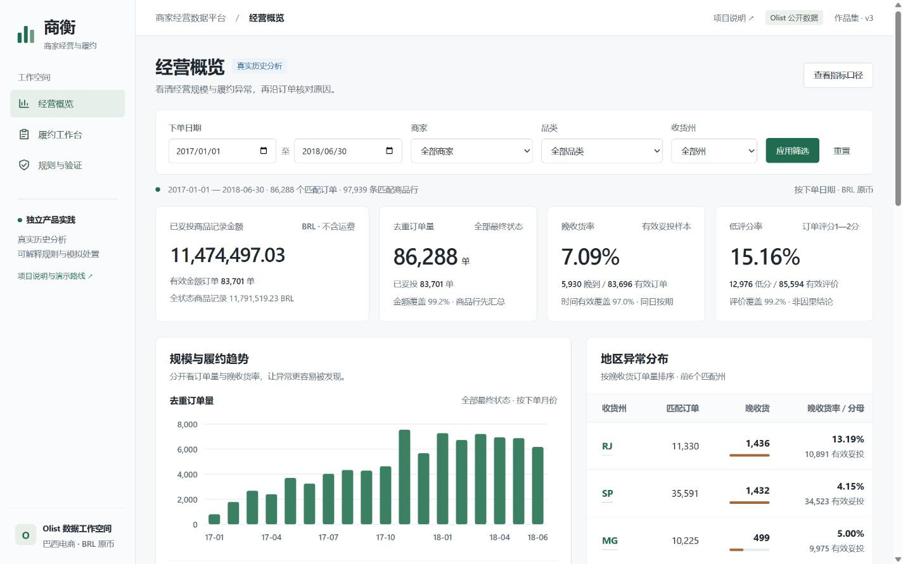

# 商衡 · Olist 商家经营与履约工作台

一个面向产品经理、产品运营和商业分析校招展示的个人产品实践。基于 Olist 公开匿名历史数据，将经营异常分析、订单核查、可解释规则与模拟处置连成可操作的流程。

作者为广州医科大学 2027 届医学检验技术本科生。项目由 AI 辅助实现；作者主要负责问题定义、需求梳理、指标检查、功能验收与产品反馈。项目没有真实商家采用、用户反馈或业务改善证据，也不代表 Olist 官方产品。

## 在线体验与交付状态

| 交付项 | 当前状态 |
|---|---|
| 公开 HTTPS 演示 | [进入商衡工作台](https://olist-merchant-workbench.luozilong888.chatgpt.site/) · [项目说明](https://olist-merchant-workbench.luozilong888.chatgpt.site/case.html)；已公开部署，核心交互验收完成 |
| GitHub 仓库 | [v123-tech/olist-merchant-operations-dashboard](https://github.com/v123-tech/olist-merchant-operations-dashboard)；已创建，源文件尚待上传 |
| 运行方式 | 静态页面与浏览器内计算，无需访客安装 Python 或注册账号 |
| 产品截图 | 已加入本地浏览器实拍与公网订单详情实拍 |



[履约工作台](docs/screenshots/workbench.png) · [规则与验证](docs/screenshots/validation.png) · [订单详情](docs/screenshots/order-detail.png) · [项目说明](docs/screenshots/case.png) · [手机项目页](docs/screenshots/mobile-case.png)

## 业务问题与产品目标

经营汇总能显示晚收货比例，却不能直接回答“检查哪一单、为什么、下一步做什么”。本项目先统一订单、商品、付款和评价粒度，再将月份与地区异常转成可以下钻的订单和履约核查队列。目标角色与工作流程属于产品假设，仍需真实目标用户验证。

## 三大核心功能

| 页面 | 可以操作什么 | 需要理解的边界 |
|---|---|---|
| 经营概览 | 按日期、商家、品类、收货州筛选；看规模、金额、晚收货趋势；下钻订单 | 金额归属匹配商品行，履约结果仍是整单结果，不能直接归责单个商家 |
| 履约工作台 | 选择历史时点；筛选 R1—R4 规则和处置状态；核对可见事件；保存或重置模拟记录 | 事件只显示到指定时点；当前浏览器的模拟操作不改变历史物流结果 |
| 规则与验证 | 查看规则条件、时间留出结果、样本筛选和数据质量 | 离线回放与截止监控能力不等于真实预测效果或延误减少 |

面试建议路线：经营概览默认窗口 → 筛选 RJ → 重置 → 履约工作台默认时点 → 核查一笔订单并保存模拟处置 → 规则与验证。完整讲解见 [面试展示材料](docs/面试展示材料.md)。

## 数据来源与指标口径

数据来自 [Brazilian E-Commerce Public Dataset by Olist](https://www.kaggle.com/datasets/olistbr/brazilian-ecommerce)，固定使用官方接口版本 2。原始 9 个 CSV 包含 99,441 笔订单；时间沿用源数据未注明时区的原始值，金额使用巴西雷亚尔 BRL。

业务发现窗口为 2017-01-01 至 2018-06-30，包含全部状态 86,288 笔订单。晚收货率只以时间有效的已妥投订单为分母：

| 范围 | 晚收货 / 有效妥投订单 | 比例 |
|---|---:|---:|
| 全部收货州 | 5,930 / 83,696 | 7.09% |
| RJ | 1,436 / 10,891 | 13.19% |
| SP | 1,432 / 34,523 | 4.15% |

实际收货日期晚于承诺收货日期才记晚收货，同日按期；未收货、取消或时间无效订单不当作按期。商品金额是匹配商品行 `price` 的记录金额，不含运费，不是净收入、结算额或利润。详细定义见 [数据口径与清洗说明](docs/数据口径与清洗说明.md)。

## 产品设计与关键决策

- 订单、商品、付款与评价先按各自粒度处理，再关联，避免一对多连接放大订单和金额。
- 同时展示数量、比例和分母；RJ 与 SP 晚收货数量接近，但比例差异对应不同的检查范围。
- 使用可解释的截止规则，展示触发原因、可见事件和建议检查动作，先验证核查流程。
- 将历史事实、规则模拟、当前浏览器处置记录分别标识；不把点击“已处理”写成真实业务改善。
- 保留现有三页交互，部署时只迁移数据读取与模拟状态保存方式。[PRD](docs/PRD_商家经营与履约工作台.md)保留原产品设计依据。

## 系统架构

```text
官方原始 CSV（本地，不随网站发布）
    ↓ Python / SQL 清洗、事实表、历史验证
本地 SQLite + 冻结规则配置
    ↓ 只读白名单导出
dist/data/ 压缩列式 JSON + 汇总报告
    ↓ HTTPS 静态托管
浏览器页面 → Web Worker 筛选 / 聚合 / 历史时点回放
           → localStorage 保存当前浏览器模拟处置
```

在线运行不需要 Python、服务器磁盘或远程处置数据库。完整保留 99,441 笔订单与 112,650 条商品行；两份主数据压缩后合计约 15.18 MB（十进制）。默认经营汇总独立加载，完整筛选和详情按需初始化数据。源码保留 Python 计算链路以便复核。[部署方案与审计](docs/部署方案与审计.md)说明方案比较和边界。

## 历史规则回放

R1 为交运截止前 24 小时临近提醒；R2 为交运截止已过；R3 为承诺收货截止前 24 小时提醒；R4 为承诺截止已过的监控。一单一个任务，保留全部触发原因，按 R4 → R2 → R3 → R1 排序。

事件在记录时间小于等于所选时点时才可见；商品属性与截止在批准后假设已知且不再修改。回放响应隐藏未来收货、最终状态、晚收货标签和评分。但完整公开历史资源可被下载，页面遮蔽不是数据保密控制。

回放样本限最终妥投、单商品行且时间有效等合格订单，存在事后选择偏差。规则先冻结，再按 7 月调试、8 月留出评价。8 月合格样本 5,662 单中，351 单最终晚收货；交运规则 R1+R2 在截止前提示 1,432 单，其中 246 单最终晚收货，覆盖 70.09%、提示命中比例 17.18%，命中订单首次提示提前量中位数 89 小时。应同时理解覆盖和人工核查负担，不能写成“减少延误 70.09%”。原报告见 [replay_results.json](dist/data/replay_results.json)。

## 验证与测试

验证分为三层，不能互相替代：

原有 26 项接口与回放测试于 2026-10-30 重新运行通过；测试前后原始 ZIP、分析数据库及旧模拟处置库 SHA-256 不变。见 [实际日志](evidence/original_tests_current.txt) 与 [哈希回执](evidence/original_tests_current.json)。

1. 从原始 ZIP 的 CSV 独立重算订单、地区、晚收货和整数分金额，核对静态导出。[本次重算证据](evidence/raw_export_reconciliation.json)。
2. 将浏览器计算与原 Python API 对照，覆盖组合筛选、分页、详情、错误输入、规则等值边界及未来标签干扰。本次 63 个接口场景与 490 个时点场景共 1,550 项断言通过，存储适配 18 项检查通过。入口为 `tests/test_static.mjs`，证据为 [API对照](evidence/static_parity_current.txt) 与 [存储检查](evidence/static_storage_current.txt)。
3. 实际浏览器已检查内置 Chromium 与 Edge，覆盖三页、保存后刷新、重置、跨浏览器隔离、1440×900 桌面和 390×844 移动视口。详细范围见 [本地浏览器验收](evidence/browser_qa_local.json)。公网已完成默认数据、RJ/SP/日期筛选、回放、时点信息遮蔽、模拟保存刷新和验证报告核对，见 [公网主验收](evidence/browser_qa_online_primary.json)。目标地区与真实移动硬件不作未实测承诺。

公网 14 个资源均返回 HTTPS 200，脚本、样式、JSON 和压缩数据哈希与本地一致；两份 gzip 解压及行列完整性通过。[HTTPS 资源报告](evidence/https_asset_verification.json)的 38 项检查中有 4 项额外响应头检查未通过：Sites 没有应用 `_headers` 中的配置。该报告保留 `passed:false`，不能将其写成全部通过。此文件可用于支持 `_headers` 的静态平台，但当前 Sites 未提供这四项额外头保证。

[公网补充验收](evidence/browser_qa_online_secondary.json)记录商家/品类、历史下钻、跨浏览器隔离、手机概览与工作台、重置和本机预览停止后的公开刷新；[故障恢复记录](evidence/browser_qa_failure.json)区分前次隔离页面实际执行与本轮证据整理。公开网址不依赖本机 Python 运行。

## 本地运行

网站已包含静态演示资源，无需安装前端依赖。用任意静态 HTTP 服务托管 `dist`，例如在仓库根目录：

```powershell
python -m http.server 8765 --bind 127.0.0.1 --directory dist
```

浏览器打开 `http://127.0.0.1:8765`。不要双击 `index.html`，Web Worker 和资源读取需要 HTTP/HTTPS。公开演示发布后不需要访客执行此命令。

使用近期 Chrome、Edge、Firefox 或 Safari；完整数据解压依赖 `DecompressionStream`。模拟记录限当前网站、当前浏览器配置文件；同一浏览器的标签页共享，不跨设备同步。清理网站数据、无痕窗口结束或更换域名会失去对应记录，存储失败会明确提示。

若已有原始项目数据，可核对和重建：

```powershell
python scripts/export_static.py --source ../../olist_project
python scripts/verify_raw_export.py --source ../../olist_project
$env:OLIST_PYTHON = (Get-Command python).Source
node tests/test_static.mjs ../../olist_project
npm run check
```

完整分析复现需要 Python 3.12、`requirements.txt` 中的 pandas、官方版本 2 原始 ZIP 及来源回执，见 [维护与更新](docs/维护与更新.md)。不从公开仓库下载本地原始数据库。

## 数据许可及项目限制

数据与基于其改编的分发材料保留 [CC BY-NC-SA 4.0](https://creativecommons.org/licenses/by-nc-sa/4.0/) 的署名、非商业、相同方式共享条件。已进行清洗、聚合、金额转换、规则回放和静态导出；原提供方未参与或认可本项目。参见 [SOURCE_LICENSE.md](SOURCE_LICENSE.md)。程序代码的许可状态另见 [CODE_LICENSE.md](CODE_LICENSE.md)，不能把数据许可扩大为所有软件代码的许可。

没有实时数据接入、真实通知、账号权限、多人任务协同或目标用户试点。下一步应开展目标用户任务观察，并在授权数据上影子运行，检验可行动率、处理负担和漏检成本。部署完成只能说明作品网站上线，不能说明商家业务系统已投入使用。
