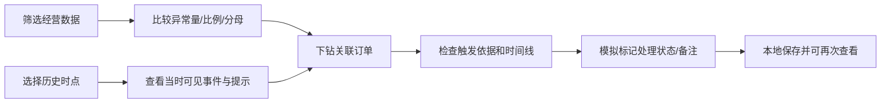

# PRD v1｜商家经营与履约工作台

> 本文保留 2026-10-09 的首版产品需求与当时状态。后续静态部署与浏览器状态隔离变更见[部署方案与审计](部署方案与审计.md)，当前交付状态见[README](../README.md)。

项目类型：公开真实历史数据上的独立产品实践；本地可运行原型。版本日期：2026-10-09。用户、流程与处置方式是待真实用户验证的产品假设；没有生产部署、真实用户效果或企业任职。

## 问题与定位

为商家运营提供“经营诊断—订单检查—处置留痕”的统一工作台。历史统计帮助找到异常群体；时间回放帮助解释在指定时点为什么提示一单；本地处置帮助展示闭环流程。

已执行分析的依据：开发窗口有效妥投83,696单，晚收货5,930单（7.09%）；2018-03下单群体晚收货比例18.96%；RJ与SP异常数量接近而比例差异明显；晚到组在运输阶段观察到更长的耗时；评分关系对回答时点敏感。详见第二阶段报告及原始证据CSV。

因此先做数量与比例共同呈现、地区/时期筛选、完整履约时间线，以及交运前/运输中提示。数据只能说明值得检查的现象，不能判定具体商家/物流责任。

## 用户角色与场景假设

| 角色 | 任务 | 本地原型中的支持 |
|---|---|---|
| 商家经营负责人 | 看经营变化，确定值得检查的异常群体 | 日期/品类/收货州筛选，商品金额、订单数、异常数量及比例，下钻订单 |
| 订单履约专员 | 判断先处理哪一单，理解提示依据 | 历史时点队列、截止/事件时间线、规则说明及处置状态 |
| 平台运营/物流协作人 | 协调无法由商家单独解决的履约问题 | 备注中记录拟协调事项；原型不向外部发送消息 |

商家切换是筛选演示，不是真实多租户权限。数据没有员工与操作日志，本项目不能宣称需求调研已完成。

## 范围与业务流程

三页：经营概览、履约工作台、规则与验证。订单详情用侧栏，减少跳转。

P0：可信数据底座、经营筛选/下钻、规则队列、可解释详情、处置保存、历史回放与证据说明。

P1：经过用户验证后扩展商家风险分层、同商家多商品行、导出和操作效率指标。P2：复杂预测、AI摘要、消息推送、实时物流、库存/成本管理、生产级权限。首版不需要这些功能来证明核心能力。

## 经营概览

- 默认窗口2017-01-01—2018-06-30；按下单日期，截止日期包含当天。
- 支持商家、品类、收货州筛选。金额来自匹配商品行；订单数及订单级履约/评分结果按关联订单去重。
- 主金额为已妥投商品金额，原币BRL，不含运费；标签说明GMV代理，不能写净收入或利润。
- 晚收货显示分子、分母与有效样本覆盖；有评价订单覆盖单独显示。分母0显示“不适用”。
- 月度变化按下单月份；州比较同时显示异常数量、比例与样本量，不用单一排名认定责任。
- 商家/品类过滤后，订单结果代表关联订单体验，不代表该商家或品类独立履约责任。
- 未限定商家/品类时保留没有商品行的订单；显示金额覆盖而不伪造0元销售。
- 下钻列表分页，详细订单可查看商品、金额、最终历史事件及质量提示。经营页始终标记“真实历史统计”。

## 历史回放与规则

回放页始终标记“历史模拟”。可选历史日期时间，时间按照数据集无时区原值，不改成北京时间；操作记录另使用当前时间。

首版只回放最终已妥投、单商品行、完整有序事件、合理交运截止和结果已在人工C前观察到的订单。C固定为2018-10-01 00:00排他，不是已知抽取完整时间。成功妥投筛选是事后样本选择，不能外推全量实时队列。

| 规则 | 条件 | 解释/建议 | 评价类型 |
|---|---|---|---|
| R1 交运截止临近 | 已批准、无截至t已发生交运事件，距离交运截止≤24小时且截止未过 | 检查备货与交接安排 | 截止前提示 |
| R2 交运截止已过 | 已批准、交运截止<t，仍无已发生交运事件 | 优先检查交接记录，必要时协调平台/物流 | 交运异常；承诺收货前触发可另评价提前提示 |
| R3 收货承诺临近 | 截至t无收货事件，距承诺日期次日00:00≤24小时但尚未到期 | 检查运输状态及拟沟通事项 | 临近承诺监控；覆盖晚到是规则定义带来的结果，不是预测模型能力 |
| R4 收货承诺已过 | t≥承诺日期次日00:00，仍无收货事件 | 已逾期，优先检查与协调 | 逾期监控，不能算提前成功 |

整点每小时检查；记录事件时间≤t即视为已发生。交运截止含具体时刻，承诺客户收货按日期结束处理。截止恰好等于t还不是交运逾期；收货事件恰好发生于t则不提示未收货。

触发只使用白名单时点快照。批准后才暴露静态商品/金额/截止字段，是明确模拟假设；原始数据没有字段建立/更新、入库延迟和承诺修改日志。最终status、未来评分、未来事件、实际总耗时、最终晚到标签与样本合格标记不进入快照或触发。

一订单一条队列任务，保留多条matched_rules；展示最高优先级R4>R2>R3>R1，说明其他触发原因，不重复计数。同一订单重复检查不新增一套任务。排序帮助检查，不展示未经训练或校准的“风险概率”。

## 详情、处置与异常处理

历史详情显示最终历史事件；回放详情只显示当时已发生事件，未来字段直接省略。未发生事件写“截至该时点尚无记录”，不猜测缺失原因。订单ID匿名化，商家以ID片段展示，不编造公司名称。

处置状态：待处理pending、处理中processing、已处理resolved、忽略ignored。状态与备注保存在本地独立SQLite，不修改原始数据或真实履约结果。忽略必须填说明；重复提交同状态同备注幂等，不重复添加历史。再次改状态需留下新的当前操作记录。

“已处理”代表演示中的人工标记，不等于成功消除延迟；原始收货事件不会因操作变化。回放时点是2018年，保存操作发生于当前演示时间，不能声称在2018年已真实处理。

| 异常情况 | 产品行为 |
|---|---|
| 筛选后无订单/无有效样本 | 显示空态及当前条件，指标不伪造为0% |
| 未知品类/无映射 | unknown或原始标签，保留订单/金额 |
| 关键时间缺失/倒置/截止不合理 | 历史详情保留质量提示；首版回放不使用该订单 |
| 多商家或多商品行 | 历史金额与关联订单描述仍可查看；首版回放范围不纳入 |
| 请求格式错误/未知订单 | 可理解的错误提示；不保存无效处置 |
| 保存失败 | 保留当前输入，显示失败并允许重试，不显示成功 |
| 页面刷新 | 从本地记录恢复最新处置，继续显示模拟标记 |

## 接口与数据约束

本地HTTP服务只监听127.0.0.1；静态资源白名单；SQL参数化；分页上限200；不访问外部服务。核心接口为meta、overview、orders、order、alerts、quality、replay_report及action。

分析与回放分别取历史事实和时点白名单。禁止把数据库整行作为回放详情返回。UI和API都需要检查未来事件遮蔽。处置表与原始/处理数据库分离，重新分析不会丢失本地操作记录。

## 验收与验证

| 检查 | 通过依据 |
|---|---|
| 经营汇总可信 | API订单数/金额与独立SQL同筛选条件相等；商品多行/付款多行不放大 |
| 日期/商家/品类/州筛选 | 列表、卡片与明细一致；日期当天包含；分页无重复 |
| 时间回放 | 未来事件/最终标签不返回；整点/截止/同日收货边界通过 |
| 规则解释 | 每个提示能指出已知字段、截止和规则；多规则一任务 |
| 本地闭环 | 忽略需备注；保存可刷新恢复；重复提交幂等；原履约数据不变 |
| 质量与空态 | 无效/未知/无样本有明示说明，没有假精确风险 |
| 模拟报告 | 分窗E/A/L、分规则与合并、提前/逾期、C和样本偏差清楚呈现 |

业务价值仍待验证：先做目标用户任务观察，再经授权影子运行记录实际告警量、确认与处理耗时；干预试点再评价晚收货变化。当前不声称需求已获用户认可或业务指标提升。

## 后续真实验证方案

1. 招募3—5名有店铺经营/履约经验的人做初步访谈或可用性观察。该人数只用于探索，不作满意度统计推广。问题围绕当前工具、异常处理路径、哪些事件可行动、每日检查容量。
2. 给出查找异常群体、解释一单触发原因、标记处理、刷新恢复四个任务。记录完成情况、耗时、误解和原话，区分真实运营人员与代理参与者。
3. 经业务授权影子运行至少一个完整业务周期，先不自动干预订单；检查事件入库延迟、截止更改、多包裹与状态日志，补齐本数据缺失的信息。
4. 再设计按商家/操作团队分组的对照试点，防止同一操作员同时处理两组导致串扰。先估算基线、最小有意义差异和样本量；结果用晚收货率，护栏用人工负担、重复提示和客户沟通异常。
5. 没有真实数据授权或参与者时保留为方案，不填写执行结果。
