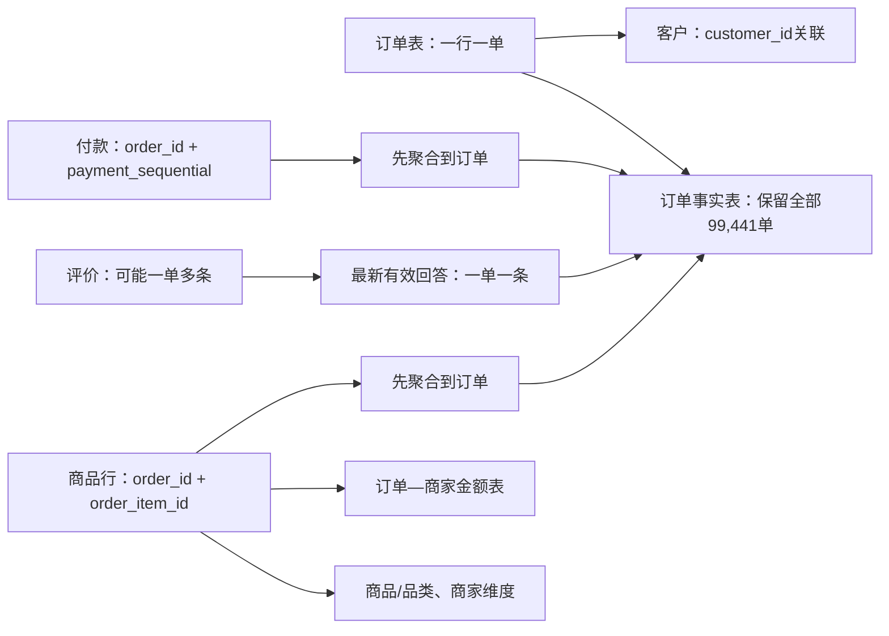

# 数据口径、关系与清洗说明

> 历史口径文档：保留原数据处理定义。当前静态导出方式见[部署方案与审计](部署方案与审计.md)；新验收结果以[README](../README.md)和本次证据为准。

这是公开真实历史数据上的独立实践，不代表企业实习、真实后台上线或业务干预。原始ZIP不修改；清洗是增加类型、聚合和有效性标记，不把异常订单从所有分析中删除。

## 数据关系与粒度

- `fact_orders`：一行一个order_id，包含订单事件、订单商品/运费/付款金额、有效性标记与用于最终历史分析的评价。
- `fact_order_sellers`：一行一个order_id + seller_id，只有该商家的商品金额、运费、商品行数，以及关联订单的下单/最终状态/收货州。不拆分订单级付款、评分或包裹事件。
- `raw_items`：原始商品行加整数分金额和品类标签。筛选商家/品类后，金额取匹配商品行；履约与评价取关联的去重订单，必须注明不是商家责任归因。
- 客户关联用`customer_id`，跨订单识别客户用`customer_unique_id`。商品行序号`order_item_id`不是数量，不能把序号求和当销量。
- 不将邮编坐标直接连接到订单。原始地理表一邮编多行，首版使用州/城市即可。

## 清洗政策

1. 对照下载回执校验ZIP哈希，读取原始文本保留ID、邮编和金额原貌。
2. 检查主键、复合键和核心外键。关键键出现意外重复或空值时中止构建，不任意保留第一行。
3. 金额用Decimal转换为整数分，原币种为BRL。`10.20`存为1020分，避免浮点求和误差。付款与商品加运费有差额时保留两边原金额。
4. 时间按原始无时区时间解析，保留缺失；不填0、平均数或当前时间。
5. 品类英文翻译缺失时回退原始葡萄牙语标签；原品类缺失显示unknown，不丢弃金额或订单。
6. 对订单/商品/付款分别聚合，使用明确的关联验证，再左连接订单基表。没有商品、付款或评分的订单仍然保留。
7. 评价先检查：评分1—5、回答时间不早于下单、调查创建日期不早于下单日期。按日期比较创建字段，避免午夜时间导致同日误判。每单取最新有效回答；并列按创建时间、review_id字典序、原始行号稳定选择。
8. `review_id`并非全局独立评价键。相同评价可能关联同一客户的多个订单；订单级评分统计不能称为独立客户反馈人数。评分冲突和多条评价另有质量记录。
9. 异常仅影响依赖它的指标。交运早于批准使交运耗时无效，但收货与承诺时间可信时仍能用于晚收货分析。

## 指标字典 v1

默认业务发现窗口：2017-01-01≤下单时间<2018-07-01。2018-07为规则验证窗口，2018-08为冻结规则留出。全量数据另用于结构核验，不混用窗口数字。

| 展示指标/字段 | 粒度及计算 | 有效范围与用途 |
|---|---|---|
| 订单数 | 所选下单日期/筛选范围内去重order_id | 默认包含各最终状态；商家/品类筛选需有匹配商品行 |
| 已妥投商品金额 | delivered订单匹配商品行price_cents之和/100 | GMV代理，不含运费，不是利润/结算收入 |
| 商品金额覆盖 | 有有效商品金额的订单数/所选去重订单数 | 缺商品行不作为0元订单解释 |
| 运费 | 匹配商品行freight_cents之和/100 | 收取/记录的运费，不等于承运商成本 |
| 付款记录金额 | 先按订单汇总payment_cents | 没有付款事件时间，不能算按回款月的现金流；不得按多商家复制 |
| 对账差额 | payment_amount_cents-item_amount_cents-freight_amount_cents | 仅两边记录有效的可比订单，差额作为诊断 |
| 客单价 | 同范围有效商品金额/同范围有商品金额的订单数 | 说明状态及是否含运费 |
| 晚收货有效样本late_valid | delivered，实际/预计/下单时间有效，实际≥下单，承诺日期结束>下单 | 不要求批准/交运时间完整，避免无关字段使分母减少 |
| 晚收货is_late | 实际收货时间≥承诺日期次日00:00 | 同一天任何时刻收货均按时；无有效结果则空值 |
| 晚收货率 | 有效样本晚收货数/有效样本订单数 | 显示分子、分母和所选订单中的覆盖率 |
| 晚收货天数 | max(实际收货日期-预计收货日期,0) | 日历日期差，非额外准确小时 |
| 批准耗时 | approved-purchase，小时 | 两时间有效且非负；缺失或负值不填0 |
| 交运耗时 | carrier-approved，小时 | 两时间有效且非负；不是完整商家备货工时 |
| 运输耗时 | delivered-carrier，小时 | 两时间有效且非负；无法直接判定承运商责任 |
| 完整流程比较timeline_valid | 五个关键时间可用，purchase≤approved≤carrier≤delivered | 阶段间联合比较采用同一分母，和单阶段局部统计区分 |
| 低评分比例 | 最新有效回答中score≤2的订单数/有有效回答订单数 | 描述历史关联，显示评分覆盖；不是NPS或因果效果 |
| 收货后评分敏感性 | 上述基础再要求answer≥delivered | 与含收货前反馈的口径并列，说明反馈时点差异 |
| 回放合格replay_eligible | 最终妥投、单商品行、完整有序时间、交运截止≥批准且早于承诺结束、有效晚到结果、实际收货<C | 成功妥投样本的机制验证，存在事后选择偏差 |

历史最终评分只用于描述分析。回放触发时禁止使用最终状态、未来评分、未来事件或最终耗时。批准后可见静态商品/截止字段是模拟假设，数据没有承诺更改和事件入库日志。

## 保留与隔离

- 未收货、取消、不可用订单：保留在状态/订单数分析；不填入“已完成晚收货率”的分母。
- 无商品行：订单保留，金额未知，并显示覆盖率；不要静默内连接删掉。
- 多商家：金额仍按各商家商品行归属，订单履约结果不能逐商家定责；首版回放不纳入。
- 交运截止异常：保留订单和金额，标记待核查；首版规则不使用不合理截止。
- 回放人工截止C固定为2018-10-01 00:00（排他）；不是已知源数据抽取完整时间。C后签收、未得到可信结果等情况单列，不能填成正常。

## 如何复现与核对

在项目目录依次运行：`python audit_stage1.py`、`python pipeline.py`、`python verify_stage2.py`。现有bundledPython路径在README中列出。需要pandas，其他核心处理用Python标准库和SQLite。

- `pipeline.py`生成处理数据库、事实表CSV、质量标记及业务证据。
- `sql/analysis.sql`包含可直接阅读和执行的业务查询，每个查询有名称，并导出对应CSV。
- `verify_stage2.py`重新读取原ZIP，用csv/Decimal和SQLite独立核对订单保留、金额、晚收货日期边界和回放范围；不只检查pipeline自己生成的摘要。
- `work/independent`和`work/quality`保留另外两条原始数据复核路径。它们的统计范围/评价选取略有差异时需先核对口径，不能把小数差异自动当代码错误。

最关键的面试解释：先决定“一行代表什么”，再算数字；所有异常都有去处，不是把不合意的数据删掉；每个比例都有分母，每个结论都有窗口；最终历史信息不能伪装成当时已知信息。
